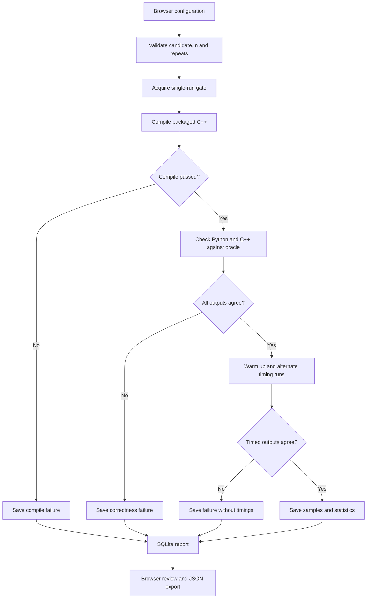

# Architecture and flow

FastAPI serves a static browser UI. The benchmark route uses a fixed workload registry; it does not accept arbitrary executable input. SQLite saves complete reports. Optional hosted generation is a separate path with no connection to the runner.

A provider proposal has a different lifecycle: user confirms → fixed Python fixture is sent → C++ response is rendered as plain text → optional `.cpp.txt` download. There is no API to run that response. AI model names, generated claims or performance claims never override the trusted candidate registry.

## Components

| File | Responsibility |
|---|---|
| `workload.py` | Fixed source registry, input bounds, fixture sizes and independent closed-form oracle |
| `runner.py` | Compiler invocation, limits, correctness gate, alternating wall timing, statistics and evidence |
| `provider.py` | Optional generation with timeout and sanitized errors; never calls execution functions |
| `storage.py` | Parameterized SQLite report persistence and recent-report summaries |
| `app.py` | Strict API schemas, host/origin validation, request-size check and per-process concurrency gate |
| `static/index.html` | Program inspection, experiment controls, fixture table, timing evidence and downloads |

## Execution and data contract

Only integer n from 0 through one million is supported. Python and C++ each read n from argv and write one nonnegative integer to stdout. Oracle computation is independent of both loops. Fixed fixtures include zero, one and the upper bound; the requested n is checked before it is timed. The incorrect candidate changes `i <= n` to `i < n`; the compile-error candidate intentionally references an undeclared name.

For each child, the server launches a fresh Python interpreter that installs Linux resource limits and execs a fixed command. The subprocess receives an explicit minimal environment, so hosted credentials are not forwarded. This is resource control, not filesystem/network isolation. The compiler is a trusted local toolchain. No arbitrary code upload, source editing, execution repair agent or generated-code execution is implemented.

Reports identify the candidate, inputs, full source and source hashes, fixture outcomes, compiler return code/diagnostics, Python/compiler/platform information, compiler flags, exact tolerance, timing scope and raw samples. SQLite stores one immutable JSON snapshot per report ID. Failed compile/correctness reports have null timing fields. System execution failures such as timeouts return an error and do not save a success report. Report IDs are random UUIDs; they are not authorization credentials.

## Performance interpretation

Compilation and fixed correctness checks occur outside the measured runtime loop. Both programs warm up once; measurement order alternates to reduce order drift. Wall timing includes the common resource-limit interpreter launcher, Python interpreter startup where applicable, OS scheduling and output collection. No CPU affinity, frequency locking, isolated CPU core or statistical confidence interval is implemented. Hardware metadata is best effort; processor name may be unavailable. Repeating a run under load may materially change results.

## Future extensions

Production arbitrary-code evaluation needs a separate authenticated worker service with disposable isolation, restricted syscalls, no network, no credentials, a read-only minimal filesystem, external kill controls, streaming output limits and quotas. Full equivalence requires stronger methods than examples. A broader optimizer would also need labeled workload families, overflow and floating-point contracts, generated-candidate review/versioning and reproducible benchmark hardware. None of these are claimed by this local demo.
